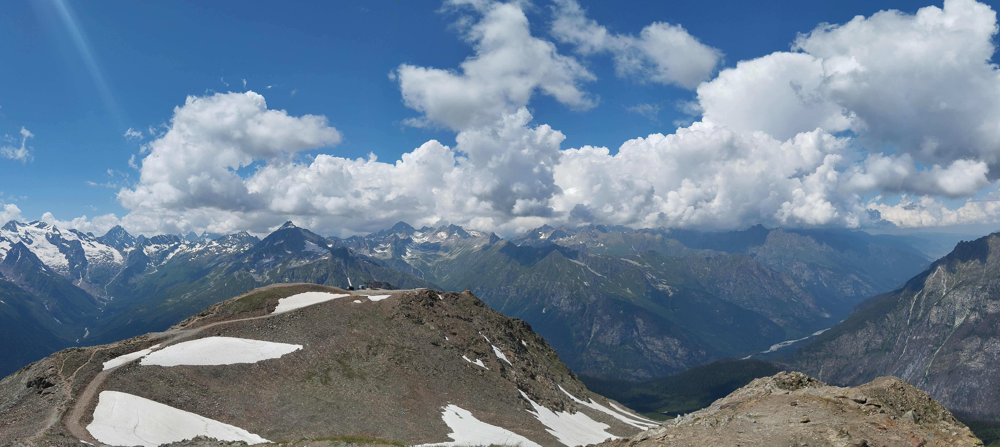

  

 

<h1 align="center">DENIS ERGOCMEN</h1>

  <strong>Learning Cloud Engineering</strong>

  <em>Exploring how systems work, how they can be built and secured, 
  and how different technologies come together.</em>

  Linux &nbsp;·&nbsp; Networking &nbsp;·&nbsp; Cloud Engineering &nbsp;·&nbsp; Python

---

## The Journey

I started my journey in **January 2026** with **Python**. Over time, I realized that technologies are tools built on deeper concepts, which led me to look beneath the tools themselves.

I then began exploring **hardware, networking, Linux, and cloud engineering**, applying what I learned through personal projects and using the experience gained to guide what I explored next.

---

## Current Focus

Strengthening my **fundamentals**, with a particular focus on **Linux**, while building **TraceBox** and applying what I learn through the project.

---

## Selected Projects

| Project | Description |
| :-- | :-- |
| **TraceBox** | My current main project and a key part of my cloud engineering journey, where I apply what I learn and use the experience gained to guide technical decisions and improvements. |
| **DeniKey** | A project that gave me experience with **security**, **user-oriented design**, and **managing a production application**. |
| **Public IP Monitor** | A project that helped me explore and understand **networking** through practical application. |

---

## Engineering Philosophy

**Problem Solving**
I prefer understanding the problem first, then finding a practical and sustainable solution rather than simply solving the immediate issue.

**Learning by Building**
I learn by understanding concepts, applying them in projects, and using the experience gained to evaluate my decisions and improve my approach.

**Trade-offs**
I am learning to evaluate trade-offs between different solutions and understand that engineering decisions often involve balancing **performance, security, reliability, simplicity, and cost**.

**Mindset**
I like to understand what is happening beneath the tools I use, question why a solution works, and look for ways to improve it.

---

## Direction

I want to build a strong understanding of the **fundamentals behind modern infrastructure and cloud systems**.

My goal is not only to use technologies, but to understand the systems behind them, how they work together, and how to make informed engineering decisions based on practical experience.

---

## Languages

Turkish &nbsp;·&nbsp; Russian &nbsp;·&nbsp; English

 

  <em>Understanding systems. Building with purpose. Learning by doing.</em>

